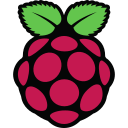

### 📊 GitHub Stats
| **Github Activity** | **Languages** |
|--------------------|---------------|
|   |   |

---

### **👤 Theimx** 

- **19yo Computer Science Student; Aspiring Software Engineer.**   
- **Python Developer; App Building & Algorithmics.**   
- **Interested in Computer Science; Biology; Robotics.**
- **Currently learning C language and Web App Building.**   

------

### 📫 How to reach me :
- **Email:** gabrielfaimali@gmail.com
- **LinkedIn:** https://www.linkedin.com/in/gabriel-faimali-a245862b6
- **Website:** https://theimx.github.io/Theimx-Homepage/

---

    
  
   
   
   

